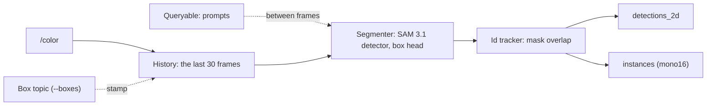

# Design

This page explains how xblick-sam3 works inside and why we decided what we decided. It also lists what the
tests check.

## The model and what the node uses of it

SAM 3.1 has two parts.

- The *detector* finds instances in one image. It consists of an image encoder, a text encoder, a transformer that
  grounds each text prompt in the image, and a mask head.
- The *video tracker* follows the detector's objects across the frames of a video. Meta calls it "Object
  Multiplex".

The node uses the detector alone. It treats every frame on its own and keeps no model state between frames. For
each prompt, it publishes the instances in the newest colour frame whose score is at least `--threshold`.



The node keeps the last `--history` colour frames (default 30). A box message and an exemplar box refer to one of
these frames by its stamp.

## Ids from mask overlap

The detector gives no identity to an instance. The node therefore matches each frame's masks to the masks of the
frame before, in `tracking.py`. [docs/topics.md](topics.md#ids) describes the rules and how stable the ids are.

## Why the node does not use SAM 3.1's tracker

SAM 3.1's own tracker runs its detector on every frame and adds a video tracker with a memory of the objects. We
measured it on the same 901 simulation frames with one word, "box", at SAM 3's commit f1647e8.

| | SAM 3.1's tracker | This node |
| --- | --- | --- |
| Time per frame | 73 ms | 29 ms |
| Ids for "box" in 901 frames | 2 | 8 |

The tracker needed 18 minutes to compile and then 149 s for the 901 frames. Its ids are steadier. We still decided
against it for three
reasons.

1. It is slower than a 30 Hz camera.
2. It cannot take a live stream. A session loads a whole video first, and it returns its results in batches of
   frames. The 901 frames of 1280 x 720 occupied 32 GB on the GPU.
3. Its `start_session` fails for SAM 3.1. It passes `offload_state_to_cpu`, and the `init_state` of the multiplex
   model does not accept that argument.

## Exemplars are encoded on their own frame

An exemplar is an example box. SAM 3's geometry encoder pools the image features inside the box, and the result
attends to the image. The encoding therefore describes the object that is in the box in that image.

The node encodes an exemplar once, on the frame in which you drew it. Every later frame reuses the encoding, as it
reuses the encoding of a text. If the node encoded the box again on a later frame, it would pool whatever is at
that place by then.

We measured both ways on TUM RGB-D (640 x 480, at 672). The only prompt was the box of one cup in frame 0, with the
text "visual".

| The node encodes the box | Result on frames 30, 90, 150 and 300 |
| --- | --- |
| once, on frame 0 | It finds the cups that the word "cup" finds, 2 to 4 per frame. The box IoU with the word's boxes is 0.6 to 0.99. |
| again on each frame | It finds 1 wrong object on frame 150. |

Meta trained SAM 3 with exemplars in the image in which they are drawn. SAM 3 does not state that an exemplar of
one frame finds its kind in later frames. This behaviour is our measurement.

## The box head

`--boxes` uses SAM 3.1's *interactive head*. It consists of the SAM prompt encoder and mask decoder of the tracker,
and it reads features from the interactive neck of the image encoder. Its weights are in the same checkpoint. The
class is `segmenter.BoxHead`.

The head segments the object in one box and does not look for others. We fed it the detector's own boxes on 10 TUM
frames, which gave 100 boxes at 672. Its masks match the detector's masks at a median IoU of 0.92. For 2 % of the
boxes, the IoU is below 0.5.

## Why the instance image is `mono16`

The other 16-bit encoding, `16UC1`, already has a meaning. REP 118 defines a `16UC1` image as depth in millimetres.
Durchblick's Rerun bridge follows REP 118 and draws such an image as a point cloud. With `mono16`, the bridge draws
the instance image over the colour image.

## Node default and class default

The node scales frames to 672. The Python class `Segmenter` keeps SAM 3's 1008 unless you pass `resolution=672`.

## Fail fast

- The node refuses a bad prompt request with an error and keeps the old prompts.
- With `CUDA_MPS_PIPE_DIRECTORY` set, the node stops at start when no MPS daemon answers.
- With `--local cuda`, the node stops when the camera offers no CUDA ring.

## Licence separation

SAM 3's code and checkpoint are under Meta's SAM License. This repository contains no copy of either. The code is a
dependency at the commit that `uv.lock` fixes. `tools/setup.sh` downloads the checkpoint.

## Tests

```bash
.venv/bin/python -m pytest tests   # needs a CUDA device and the checkpoint
```

| File | What it checks |
| --- | --- |
| `tests/test_segmenter.py` | The masks against SAM 3's own forward pass. The instance image against the masks. A frame without the words. 672 against 1008. The box head against the detector's masks. An exemplar box that finds its kind beside words that keep their instances. Refused prompts. |
| `tests/test_tracking.py` | The id rules: moving objects, new objects, too little overlap, `--max-missing`, the wrap of the ids, the instance image. |
| `tests/test_node.py` | The messages, prompt requests and colour encodings. The node as its own process on a published `bgr8` stream over real Zenoh sessions. The node with `--boxes` and its queryable. |

The process test in `tests/test_node.py` checks four things. The detections and the instance image have the
published stamps. The ids agree with the image. The pixels of each instance lie inside its box. With `--boxes`, the
node segments the given boxes on their frame, returns the prompts, accepts an exemplar and refuses a bad request.

## Status and limits

- Version 0.1.0, status of 2026-10-31. We tested the node on recorded frames and on the replayed head camera of a
  simulation. We have not tested it on a robot.
- We have not tested `--boxes` live on Boxer's boxes.
